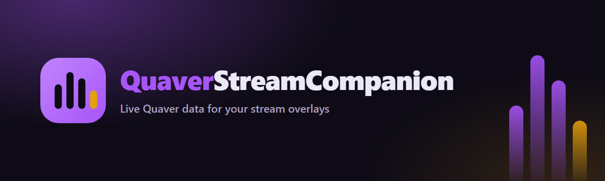
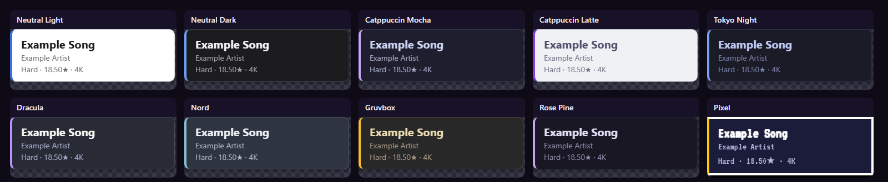
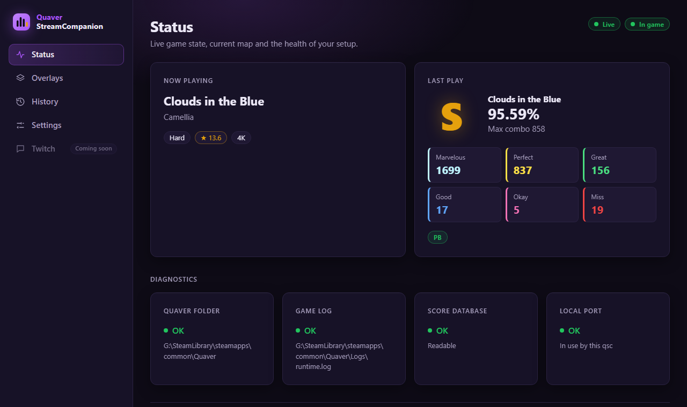
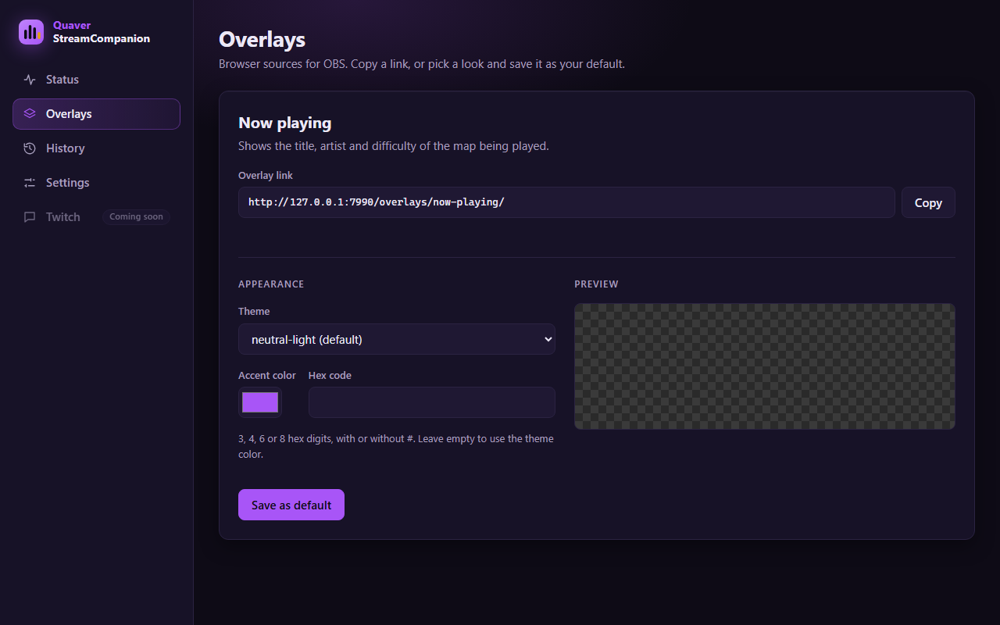
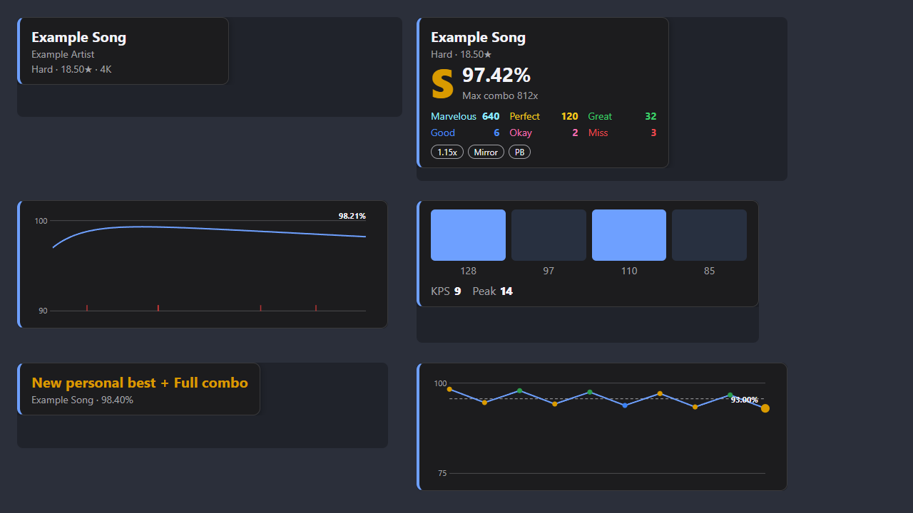
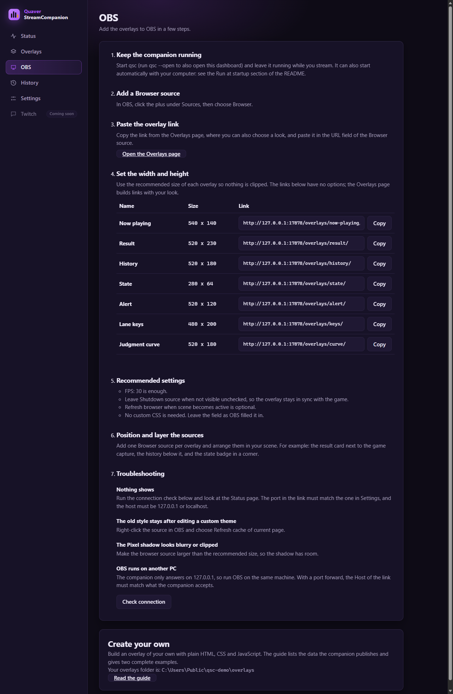
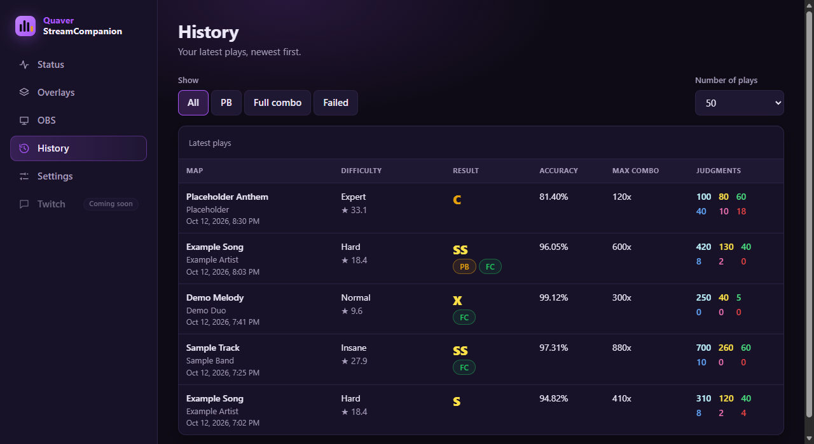
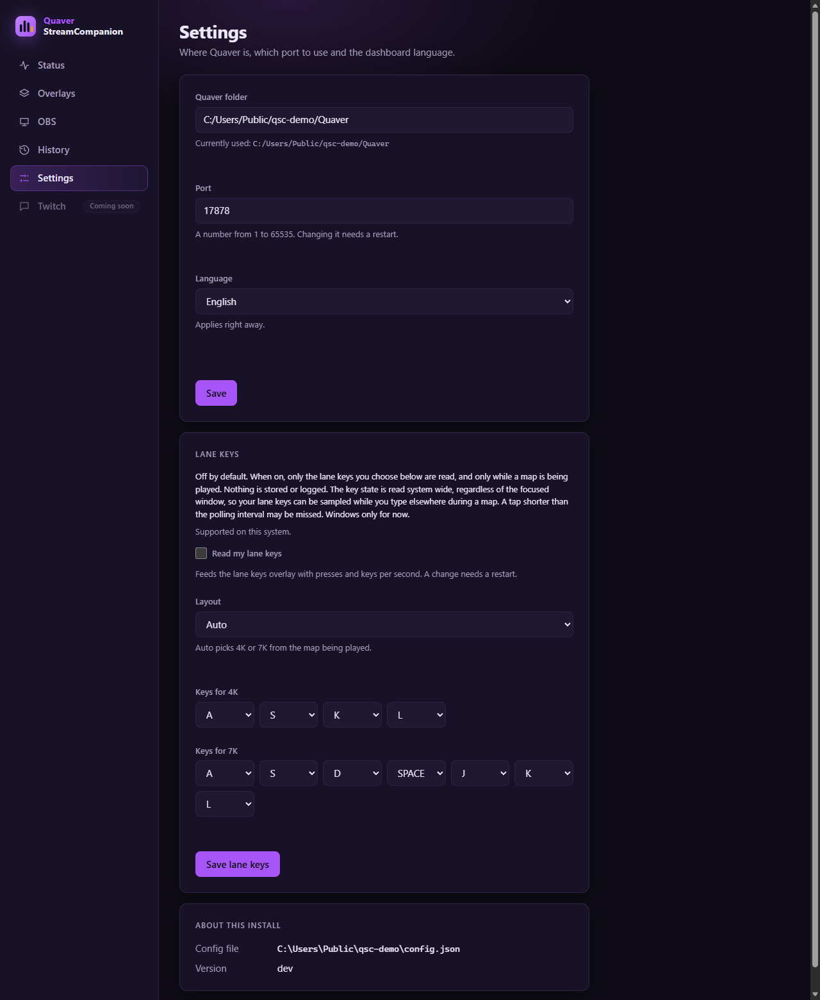

<div align="center">



# QuaverStreamCompanion

### Live Quaver data for your stream overlays, read safely from the files the game already writes

[](https://github.com/kushiemoon-dev/quaver-stream-companion/releases/latest)
[](https://github.com/kushiemoon-dev/quaver-stream-companion/stargazers)
[](LICENSE)
[](https://go.dev)


</div>

---

## Overview

**QuaverStreamCompanion** (`qsc`) is a small local app that follows your [Quaver](https://quavergame.com) games and serves what happens to your stream overlays: the game state, the map you are playing, and the result of every play.

It runs next to the game, keeps everything on your machine, and gives OBS a ready-made browser source plus a documented JSON and live-event API for anyone who wants to build their own overlay. A local dashboard in your browser shows the live status, gives you the overlay links, lists your recent plays and edits your settings.

> **Unofficial project.** Quaver is a trademark of its respective owners. QuaverStreamCompanion is an unofficial tool and is not affiliated with Quaver. It is not related to the osu! StreamCompanion tool despite the similar name.

> **Status: first stable release.** [`v0.1.1`](https://github.com/kushiemoon-dev/quaver-stream-companion/releases/tag/v0.1.1) is out. The features below are built and tested on Windows; Linux is tested in CI with simulated Steam folders, and feedback from real setups is welcome. What is planned is listed under [Roadmap](#roadmap).

---

## Features

- **Eight overlays** for OBS browser sources: now playing, result, history, state, alert, lane keys, judgment curve and session statistics (see [Overlays](#overlays))
- **11 built-in themes** and an accent color, plus [custom themes](docs/THEMES.md) and [custom overlays](docs/OVERLAYS.md) you drop in a folder
- **A local dashboard**: live status, overlay links with a theme picker, an OBS setup guide, your play history and settings, in English, French and German
- **A JSON and live-event API** for your own overlays and scripts
- **Judgment timeline**: the accuracy curve of a saved play, built from the score database
- **Degraded mode**: if Quaver is not found, `qsc` still starts and tells you what to fix
- **Opt-in lane keys and KPS** (Windows only), off by default

---

## Safe by design

QuaverStreamCompanion only reads files that Quaver already writes itself:

| File | Used for |
|------|----------|
| `Logs/runtime.log` | Live game state (menu, select, loading, gameplay, results) and the "score saved" signal |
| `quaver.db` | Map being played and the result of each play (opened **read-only**) |

The optional exceptions are the lane keys overlay (see [Lane keys](#lane-keys)), which is off by default and works on Windows only, and the crash detection described below, which reads program names only (on Linux, plus a short look at the command line of Wine processes to find `Quaver.exe`) and can be turned off. Apart from them, `qsc` never reads game memory, never modifies or injects into the game, never talks to the game's internal ports, and never writes anything to the Quaver folder. There is no telemetry, no account and no online service: nothing is ever sent anywhere, and the server listens on `127.0.0.1` only (requests with another `Host` header are rejected). `qsc` never opens a browser by itself: it only does so with `--open`.

### Crash detection

Quaver only writes its exit line when it closes cleanly, so after a crash or a kill the game state would stay stuck until the next launch. To notice that, `qsc` looks every 10 seconds at the **names of the running programs**, only while the game is not already shown as closed, and checks whether a process named `Quaver.exe` (or `Quaver`, the native Linux build) exists. After 3 checks in a row without one (about 20 to 30 seconds) it publishes the `closed` state and writes one line in `qsc.log`. When Quaver starts again its log lines move the state out of `closed` as usual.

What is read, exactly:

- **Windows**: the executable name of each process, from the system process list.
- **Linux**: the short name of each process in `/proc/<pid>/comm`. Under Proton, a Wine loader process (a name starting with `wine`) has its command line read for a moment, only to look for the text `Quaver.exe`; it is dropped at once.
- Nothing else: no window titles, files, memory, users or other process data. No name is stored, logged, sent or served on any endpoint.
- If the list cannot be read, `qsc` does nothing and never marks the game closed. If the config file itself cannot be read, the check turns off (the conservative choice) and one line is written to the debug log. On a system where the list is not supported, the check is off.

You can turn it off with the **Notice when Quaver has crashed** checkbox in Settings (it applies right away) or with `"watch_quaver_process": false` in the config file. It is on by default, and a config file written by an earlier version without this key counts as on.

---

## Compatibility

| Platform | Status |
|----------|--------|
| Windows 10 and later | Tested |
| Linux with Steam (native build or Proton) | Tested in CI on Ubuntu (amd64 and arm64) with synthetic Steam folders (native, Flatpak, Snap, extra libraries). Not yet confirmed with a real Quaver install or Proton, and lane keys and KPS are unavailable. |
| macOS | Not supported yet. Quaver has a macOS build, but `qsc` is not built or tested there |

Lane keys and KPS work on Windows only for now. See the [installation guide](docs/INSTALL.md#linux-and-proton) for the Linux details.

---

## Quick Start

**1. Download `qsc` for your platform** from the [releases page](https://github.com/kushiemoon-dev/quaver-stream-companion/releases) (see [Install](#install)), or [build from source](#build-from-source)

**2. Check that it finds your game.** Open a terminal in the folder where you unzipped `qsc` (on Windows type `.\qsc.exe` instead of `qsc`, on Linux `./qsc`):

```
qsc doctor
```

**3. Start it and open the dashboard**

```
qsc --open
```

This opens `http://127.0.0.1:7878/` in your browser. Without `--open`, `qsc` only starts the server and never opens a browser.

**4. Add the overlay to OBS.** On the **Overlays** page, copy the overlay link and paste it into an OBS *Browser* source. The link looks like this:

```
http://127.0.0.1:7878/overlays/now-playing/
```

Then play a map. The overlay appears when you start playing and hides in the menu.

The full walkthrough, with troubleshooting, is in the [OBS setup guide](docs/OBS.md) and on the dashboard OBS page. To build an overlay of your own, see the [overlay guide](docs/OVERLAYS.md).

### Overlays

| Overlay | Recommended size | Link |
|---------|------------------|------|
| Now playing | 540 x 140 | `/overlays/now-playing/` |
| Result | 520 x 230 | `/overlays/result/` |
| History | 520 x 180 | `/overlays/history/` |
| State | 280 x 64 | `/overlays/state/` |
| Alert | 520 x 120 | `/overlays/alert/` |
| Lane keys | 480 x 200 (560 x 200 for 7K, 640 x 200 for 10K) | `/overlays/keys/` |
| Judgment curve | 520 x 180 | `/overlays/curve/` |
| Session | 480 x 170 | `/overlays/session/` |

Each link starts with `http://127.0.0.1:7878`. Use the size as the width and height of the OBS Browser source.

The result overlay shows a `#k` chip with the rank of the play on the local leaderboard of the map, a `PB` badge for a same speed personal best and a `Best` badge when the play leads the local leaderboard. The alert overlay announces a new best, a personal best or a full combo. See [Personal bests](#personal-bests).

### Run at startup

`qsc` never opens a browser unless you pass `--open`, so it can start with your computer without opening anything. It is a console program, so its window stays open: set the shortcut to run minimized. If it cannot find the Quaver folder it still starts in a degraded mode: the dashboard, the overlays and the settings work, the game state stays `unknown`, and the Status page explains what to do. Set the folder in Settings, with `quaver_dir` in the config file or with `--quaver-dir <folder>`; `qsc` re-checks every 15 seconds and starts reading Quaver by itself as soon as the folder is valid. `qsc doctor` still exits with an error in that case and prints the same advice.

- **Windows:** press Win+R, run `shell:startup`, and put a shortcut to `qsc.exe` in that folder. In the shortcut properties set Run to Minimized.
- **Linux:** run it from a systemd user service, or from your desktop autostart entries.

---

## Dashboard

The dashboard is served at `http://127.0.0.1:7878/` and needs nothing but a browser.

| Page | What it does |
|------|--------------|
| **Status** | Live game state, current map, the health of your setup and a Copy diagnostics button for bug reports |
| **Overlays** | Copy the OBS browser source link, pick a theme from the visual theme picker (built-in or your own custom themes) and an accent color, preview the result, and save it as your default look |
| **OBS** | A step by step guide to add the overlays to OBS, with the recommended sizes, copyable links and a connection check |
| **History** | Your recent plays: map, difficulty with rate and mods, grade, accuracy, max combo and judgments |
| **Settings** | Quaver folder, port, dashboard language, the config, themes and overlays paths, the version, the crash detection option, the opt-in lane keys card and a Quit button |

A **Twitch** tab is shown as "coming soon"; nothing behind it exists yet. The dashboard is available in English, French and German. The dashboard uses a dark theme; the overlays have their own themes.

---

## Themes

Overlays come with 11 built-in themes, and you can add your own.

<p align="center">
  
</p>

| Theme id | Palette |
|----------|---------|
| `neutral-light` | Original |
| `neutral-dark` | Original |
| `catppuccin-mocha` | Catppuccin |
| `catppuccin-latte` | Catppuccin |
| `tokyo-night` | Tokyo Night |
| `dracula` | Dracula |
| `nord` | Nord |
| `gruvbox` | Gruvbox |
| `rose-pine` | Rose Pine |
| `pixel` | Original, with the VT323 font |
| `neon-cosy` | Original, dark violet with soft neon glow |

**Make your own.** A theme is one small CSS file of variables. Drop it in the `themes` folder next to your config file and select it with `?theme=<id>`. See the [theme guide](docs/THEMES.md).

Palettes are credited to Catppuccin, Tokyo Night, Dracula, Nord, Gruvbox and Rose Pine (all MIT). The Pixel theme uses VT323 by Peter Hull (SIL Open Font License 1.1). Details in the [theme guide](docs/THEMES.md#credits-and-licenses).

---

## Screenshots

All screenshots use synthetic data.

<p align="center">
  
</p>
<p align="center">
  
</p>
<p align="center">
  
</p>
<p align="center">
  
</p>
<p align="center">
  
</p>
<p align="center">
  
</p>

---

## How It Works

### Endpoints

| Endpoint | What it gives you |
|----------|-------------------|
| `GET /` | The dashboard |
| `GET /state` | JSON snapshot: `game`, `map`, `last_score`, `session` and, for same-origin pages and tools without an `Origin` header, `keys` |
| `GET /events` | Live event stream (Server-Sent Events), at most 64 at once |
| `GET /events?keys=1` | The same stream plus lane key frames (`keys.frame`). Same-origin only: a cross-origin page gets `403` |
| `GET /overlays/<id>/` | Ready-made and custom overlays, for example `/overlays/now-playing/`. Shared files such as `/overlays/overlay.css` are served from `/overlays/` too |
| `GET /themes/<id>.css` | Theme files, built in and custom |
| `GET /api/status` | Setup health: Quaver folder, files and version |
| `GET /api/diagnostics` | The support report shown by the Copy diagnostics button (same-origin only, no CORS) |
| `GET /api/config`, `PUT /api/config` | Read and save the settings file |
| `GET /api/history` | Recent plays (`?limit=`, 1 to 200) |
| `GET /api/scores/{id}/timeline` | Accuracy curve of one saved play, from the score database |
| `GET /api/text/{file}` | The text of one of the now playing text files, as `text/plain` (for example `/api/text/nowplaying.txt`) |
| `GET /api/themes` | Available overlay themes |
| `GET /api/overlays` | The custom overlays folder and the custom overlays found in it |
| `POST /api/session/reset` | Clear the session statistics (same guards as saving the settings, body `{}`) |
| `POST /api/quit` | Stop `qsc` cleanly (same guards as saving the settings: used by the dashboard Quit button and `qsc stop`) |

### Events

Every event is wrapped in the same versioned envelope so your overlay keeps working when new events are added:

```json
{ "v": 1, "type": "score.saved", "time": "2026-10-12T13:06:06Z", "data": { } }
```

| Type | When |
|------|------|
| `snapshot` | Sent once when you connect, with the full current state |
| `game.state` | The game moved to `menu`, `select`, `loading`, `gameplay` or `results` (also `initialization` while the game starts, `editor`, `importing`, `download`, `lobby`, `multiplayer`, `music` or `theatre` for the other Quaver screens, and `closed` when Quaver is closed). The `/state` snapshot reports `unknown` before the first log line |
| `play.ended` | A play left `gameplay` without a saved score (autoplay, replay, quit, editor test play): `{ "map": <map object>, "saved": false }`. `game.state` also carries the raw `screen` name |
| `map.started` | A map started: title, artist, difficulty, stars, key count, mapper, BPM, length, note counts, ranked status |
| `score.saved` | A play finished: judgments, accuracy, grade, max combo, performance `rating`, `is_pb`, `local_rank`, `local_total`, `is_local_best`, `first_play`, `full_combo`, `failed`, play `rate`, `mods`, `mods_raw`, `paused` and `autoplay` |
| `session.updated` | Session statistics (plays, passes, fails, average and best accuracy, best rating, full combos, streaks), sent right after each `score.saved` and after a reset |
| `keys.frame` | Lane key state, only on `GET /events?keys=1` and only when lane keys are on (see [Lane keys](#lane-keys)) |

Score details:

- `rate` is the speed of the play (`1.0` without a speed mod).
- `mods` lists the other mods by name (`[]` when none), and `mods_raw` is the raw value stored in `quaver.db`. A negative value (Quaver "None") counts as no mods, and bits qsc does not know stay in `mods_raw` without a name in `mods`.
- `paused` is `true` when you paused during the play, and `autoplay` is `true` for an autoplay run.
- `is_pb` and `first_play` follow the rules in [Personal bests](#personal-bests).
- The map `difficulty` of a score is the difficulty at the played rate, not at 1.0x. `map.started` reports the 1.0x difficulty, since the rate is not known yet.

### Personal bests

A play is compared only with earlier plays of the same map, at the same play speed, with the same mod set. A 1.15x play is never compared with a 1.0x play, and a play with a given mod is never compared with one without it. NoFail and NoPause do not separate plays. Paused and Autoplay plays never count, and neither do failed plays. This is `is_pb`, the same speed personal best.

Quaver also keeps a local leaderboard per map that mixes every play speed and mod set. qsc ranks a play in it as `local_rank` out of `local_total`, and sets `is_local_best` when the play leads it. Quaver keeps the 50 plays with the highest score, puts failed plays last and orders the rest by performance rating, then accuracy. Quaver mixes the local profiles in that leaderboard, and so does qsc. Quaver recalculates stale performance ratings when it opens a leaderboard while qsc reads the stored value, so the rank of an old play can differ until the game has recomputed it.

### Why the result arrives at the end of the map

Quaver writes nothing about individual notes while you play, so there are no live judgments from the files it exposes. Game state and map changes are instant; the result of a play arrives the moment the game saves it. Live per-note judgments are deliberately out of scope, because getting them would mean reading the game's memory or modifying it.

### Overlay options

Overlays take URL parameters. The full table, with values, defaults and the overlays each one applies to, is in the [overlay guide](docs/OVERLAYS.md#1-the-built-in-overlays-and-their-options). In short:

| Parameter | Example | Effect |
|-----------|---------|--------|
| `theme` | `?theme=neutral-light` | Pick a theme by id (a built-in one or your own); without it, the default saved on the Overlays page is used |
| `accent` | `?accent=ff6ac1` | Override the accent color (hex) |
| `lang` | `?lang=fr` | Language of the labels: `en`, `fr` or `de` |
| `scale` | `?scale=1.2` | Size multiplier from 0.5 to 3 |
| `demo` | `?demo=1` | Show example data without connecting |
| `autohide` | `?autohide=20` | Seconds until the card hides (now playing, result, alert, curve) |
| `n` | `?n=10` | History: number of plays, 5 to 50 |
| `best` | `?best=1` | History: dashed line at the best accuracy shown |
| `meta` | `?meta=1` | Now playing: add a line with the mapper, BPM, length and note counts |
| `sound` | `?sound=1` | Alert: play a short chime |
| `counts` | `?counts=0` | Lane keys: hide the press counters |
| `peak` | `?peak=0` | Lane keys: hide the peak keys per second |
| `hide` | `?hide=menu,closed` | State: states for which the badge is not shown |

---

## Config file

Settings are stored in a JSON file, written by the Settings and Overlays pages or edited by hand:

| OS | Location |
|----|----------|
| Windows | `%APPDATA%\quaver-stream-companion\config.json` |
| Linux | `~/.config/quaver-stream-companion/config.json` (or `$XDG_CONFIG_HOME/quaver-stream-companion/config.json` when that variable is set) |
| macOS | `~/Library/Application Support/quaver-stream-companion/config.json` |

```json
{
  "quaver_dir": "",
  "port": 7878,
  "language": "en",
  "overlay": { "theme": "neutral-light", "accent": "" },
  "keys": { "enabled": false },
  "watch_quaver_process": true,
  "text_files": false
}
```

An empty `quaver_dir` means auto-detection from your Steam libraries. `language` is `en`, `fr` or `de`. `watch_quaver_process` turns the [crash detection](#crash-detection) on or off. `text_files` (off by default) keeps text files of the current map and last score in a `text` folder next to the config file, for [OBS text sources](docs/OBS.md#text-source-read-from-file); it applies right away. `accent` is a hex color without `#`. A missing file gives the defaults. Saving writes a `"version": 1` key, and keys that `qsc` does not know are kept when settings are saved from the dashboard. A change of port, or of the Quaver folder once it is in use, takes effect the next time `qsc` starts; a folder saved while `qsc` is still looking for Quaver is picked up within 15 seconds. In a hand-edited JSON path, double each backslash (`\\`) or use forward slashes.

#### Lane keys

The lane keys overlay shows a bar per lane that lights up while its key is held, a press counter per lane, the keys per second (KPS) and the peak of the map. The numbers come from raw key state, they are not note accurate judgments.

**Privacy.** Lane keys are off by default. Only the lane keys you choose are read, and only while a map is being played. Nothing is stored or logged: no key names, no key history. The key state is read system wide, regardless of the focused window, so lane key timing may be sampled while you type elsewhere during gameplay. It works on Windows only for now, and a tap shorter than the polling interval may be missed. Overlays only receive per lane on/off states, counters and KPS. The lane key data is served to pages loaded from `qsc` itself and to tools that send no `Origin` header, such as OBS and curl; a page from another origin, including a sandboxed custom overlay, gets no `keys` field and a `403` on `GET /events?keys=1`, so a web page open in your browser cannot read it.

To turn it on, use the Keys card on the dashboard Settings page, or edit the file: set `"keys": { "enabled": true, "layout": "auto", "k4": ["A","S","K","L"], "k7": ["A","S","D","SPACE","J","K","L"] }`. `layout` is `auto` (from the map's key count), or `1k` to `10k`. There is one list per layout, `k1` to `k10`, and the defaults are Quaver's own default bindings, so you only write the lists you changed. `scratch` (default `SHIFT_L`) is the key of the extra scratch lane of maps that have one; with `auto`, such a map adds that lane as the first lane. Each list holds exactly that many different key names (`A` to `Z`, `0` to `9`, `SPACE`, the arrows, `SHIFT_L`, `CTRL_L`, `ALT_L` and their `_R` twins, `;` `,` `.` `/` `'`, `F1` to `F12`). A change takes effect the next time `qsc` starts. The overlay stays blank until data arrives; if the feature is off or unsupported it shows a short hint instead.

Precedence: command-line flag, then config file, then defaults. Use `--config <path>` to read another file.

---

## Commands

Run these from the folder where you unzipped `qsc` (`.\qsc.exe` on Windows, `./qsc` on Linux), or from anywhere once it is on your `PATH`.

```
qsc                      start the server
qsc doctor               check the Quaver folder, files and port
qsc stop                 stop a running qsc (--port N and --config <path> as for serve)
qsc version              print the version (also qsc --version)
qsc -h                   list the commands and flags (also --help)
qsc doctor --report      print a redacted support report for a bug report
qsc -v                   also write debug lines to qsc.log (--verbose)
qsc --quaver-dir <dir>   use a specific Quaver folder (auto-detected from your Steam libraries otherwise)
qsc --port 7878          change the local port
qsc --config <path>      use another config file
qsc --open               also open the dashboard in your browser
```

`qsc` writes a log file, `qsc.log`, next to the config file (1 MiB at most, one older copy kept). It records start and stop, the game state, ids and settings events, never player names, key names or paths outside the Quaver and config folders. See [docs/INSTALL.md](docs/INSTALL.md#reporting-a-problem) for what to share in a bug report.

The server only answers requests whose Host is `127.0.0.1:<port>` or `localhost:<port>`, so port forwarding or a reverse proxy gets a 403.

---

## Roadmap

- [x] Game state, map and score events, local server, first overlay
- [x] Settings dashboard in the browser
- [x] Judgment curve of the last play, from the score database
- [ ] Replay analysis after each play (early / late split). Parked: it needs reading replay files
- [ ] Quaver public API: profile, rank (parked: it would be the first online feature, so it needs an explicit opt-in design)
- [ ] Optional Twitch module: chat commands (`!map`, `!last`, `!pb`) and personal best / full combo alerts
- [x] Custom overlays folder, lane keys and KPS overlay (Windows), degraded mode without Quaver
- [x] 11 ready-made themes (Catppuccin, Tokyo Night, Dracula, Nord, Gruvbox, Rose Pine, Pixel, Neon Cosy...) and a guide to make your own
- [x] Windows `.exe`, Linux binaries and AppImage releases (latest release: `v0.1.1`)
- [ ] Linux and Proton fixes after feedback from real setups

---

## Install

Releases come as a Windows zip, Linux `.tar.gz` archives (amd64 and arm64), a Linux AppImage and a `checksums.txt` file. There is no installer: unzip, check the checksum, run `qsc`. The [installation guide](docs/INSTALL.md) covers verification, starting with your computer on Windows and Linux, updating and uninstalling. The archives and the AppImage are started by the release workflow on Linux and Windows before the draft is created. Release notes are in the [changelog](CHANGELOG.md).

---

## Build from source

You need [Go](https://go.dev) 1.26 or newer. No C compiler is required.

```sh
git clone https://github.com/kushiemoon-dev/quaver-stream-companion.git
cd quaver-stream-companion
go build -o qsc ./cmd/qsc
go test ./...
```

---

## Guides

| Guide | What it covers |
|-------|----------------|
| [Installation](docs/INSTALL.md) | Download, checksums, startup on Windows and Linux, updating, uninstalling |
| [OBS setup](docs/OBS.md) | Adding the overlays to OBS, sizes, troubleshooting |
| [Overlays](docs/OVERLAYS.md) | Overlay options, the data reference and how to build your own overlay |
| [Themes](docs/THEMES.md) | Making a theme, the tokens, credits and licenses |
| [Releasing](docs/RELEASING.md) | How a release is cut, and the repository settings to check |
| [Docs index](docs/README.md) | All the guides in one list |

---

## Contributing

Issues and pull requests are welcome. Read [CONTRIBUTING.md](CONTRIBUTING.md) first: it covers the setup, the checks to run before sending a change and the commit style. This project follows a [code of conduct](CODE_OF_CONDUCT.md). To report a security problem privately, see [SECURITY.md](SECURITY.md). To add a built-in theme, follow [Contributing a built-in theme](docs/THEMES.md#contributing-a-built-in-theme). The web files are plain HTML, CSS and JavaScript with no build step and no remote resources.

---

## License and credits

`qsc` is MIT licensed. See [LICENSE](LICENSE). Theme palettes come from Catppuccin, Tokyo Night, Dracula, Nord, Gruvbox and Rose Pine (all MIT), and the Pixel theme uses the VT323 font by Peter Hull under the SIL Open Font License 1.1 ([license text](web/themes/fonts/OFL.txt)). The full table is in the [theme guide](docs/THEMES.md#credits-and-licenses). The licenses of the Go modules built into `qsc` are in [THIRD_PARTY_NOTICES.md](THIRD_PARTY_NOTICES.md); it ships inside the release archives from the release after `v0.1.0-rc1` (the `v0.1.0-rc1` archives do not contain it).
